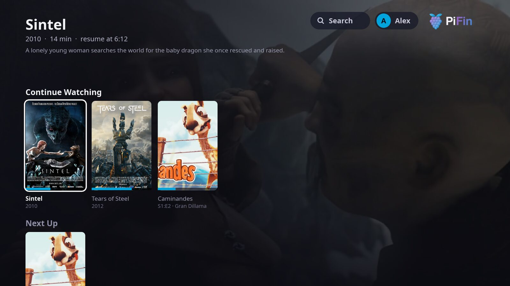
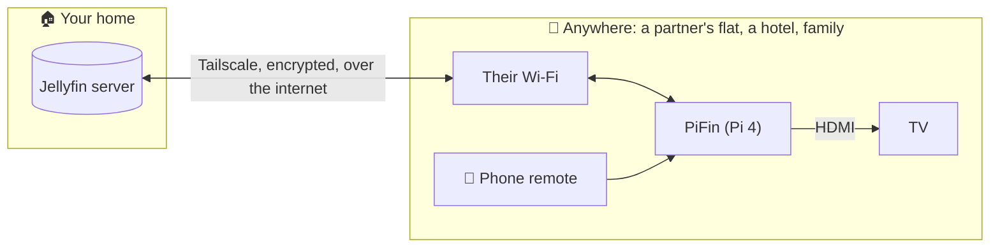
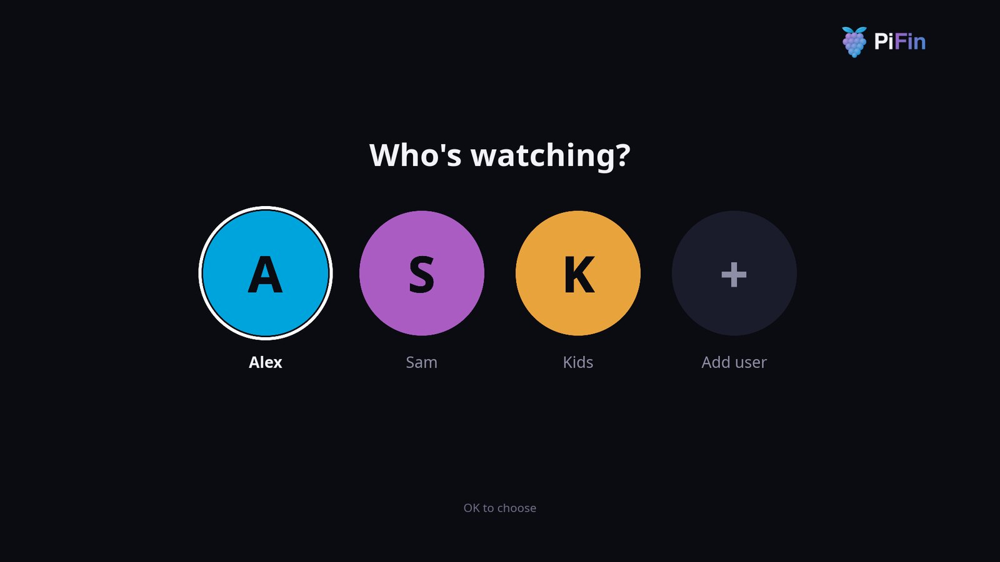
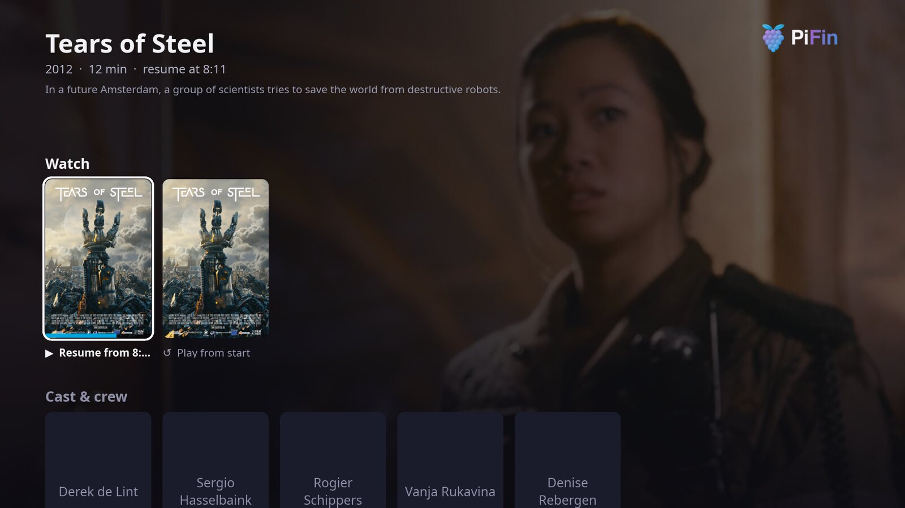
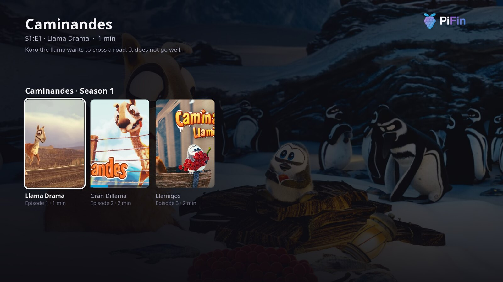
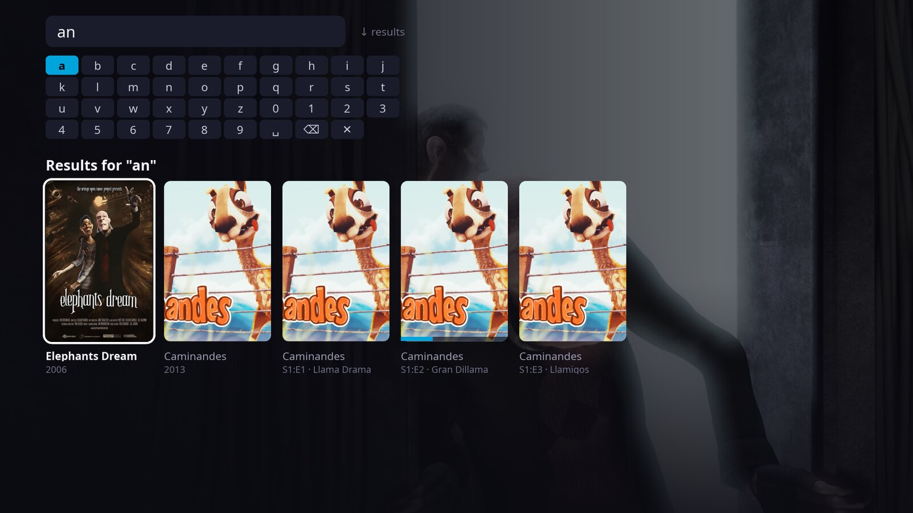
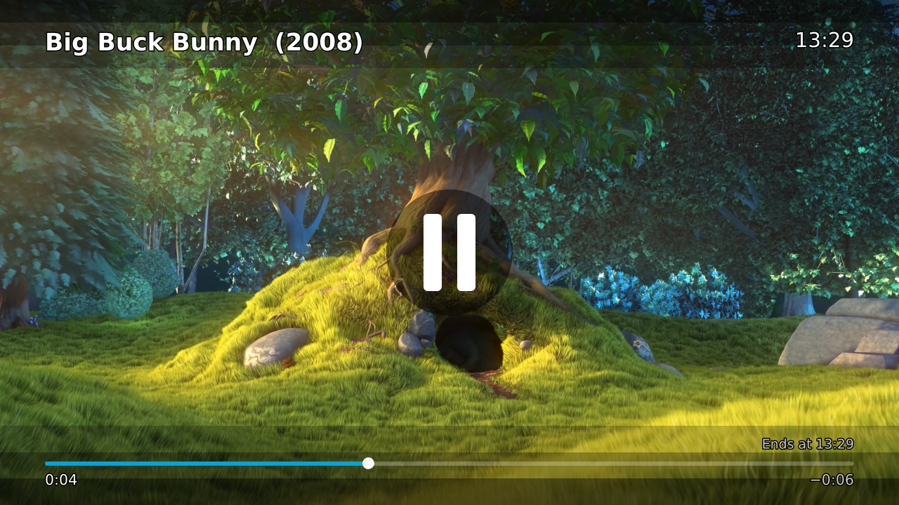
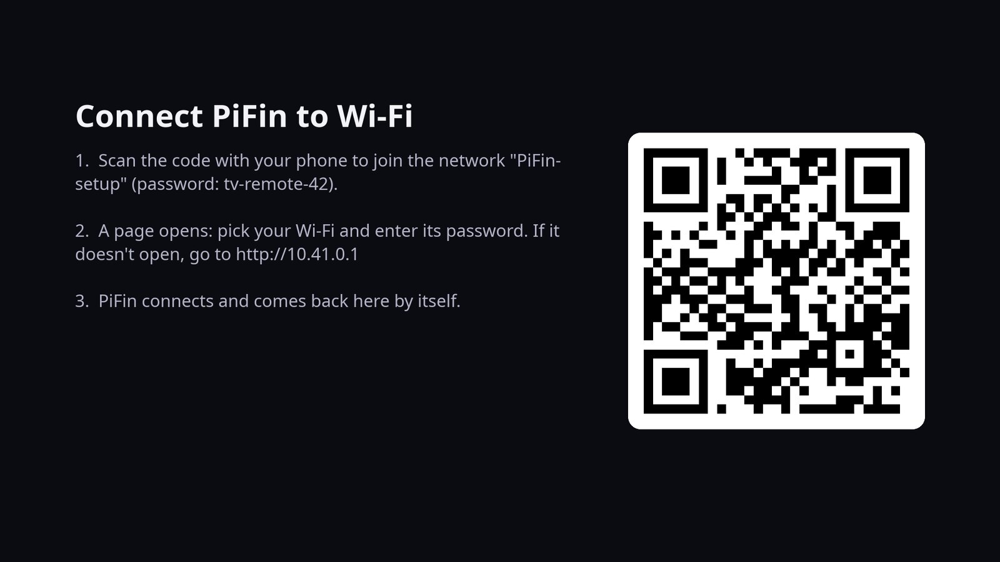
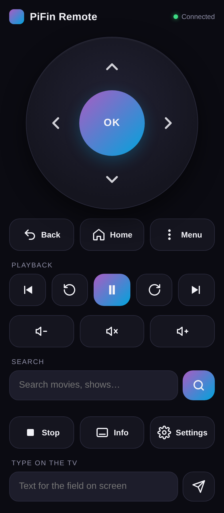
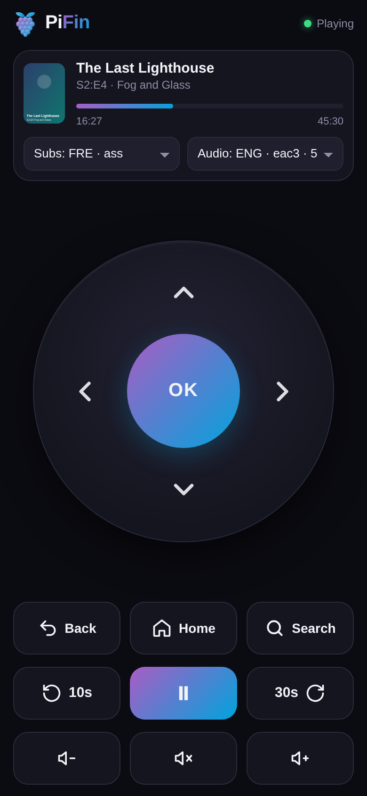

<p align="center"></p>

# PiFin

**Your Jellyfin library, on any TV, anywhere.** PiFin turns a Raspberry Pi 4 into a small box
you take with you: plug it into the TV at your girlfriend's place, a hotel room or your
parents' house, join the Wi-Fi from your phone, and watch your own library, streamed from your
server at home.

PiFin is **not a Jellyfin server**. It stores and transcodes nothing: it's a fast native client
that connects to your existing server remotely, through Tailscale or any URL the Pi can reach.

<p align="center"></p>



Nothing to open on your home router: with Tailscale the Pi and the server find each other. The
Pi plays the original file with hardware decoding, so the server never transcodes, and your
progress goes back to the server, so you pick up at home where you stopped at the hotel.

## Features

- **Who's watching?** Each profile is a Jellyfin user of your server, with their own Continue
  Watching, Next Up and resume points. The avatar at the top of the home screen shows who is
  signed in; select it to switch or to add a user with a Quick Connect code.
- **Browse:** home rows, movie pages with Resume and cast, series → seasons → episodes, and
  search (the Search button at the top) with an on-screen keyboard.
- **Playback** in mpv with hardware decoding (HEVC, 10-bit, H.264) and a light overlay for
  progress, audio and subtitles.
- **Phone remote:** a web page on port 8080, nothing to install. D-pad, now playing, seek,
  volume, tracks, search. The TV remote works too (HDMI-CEC).
- **Wi-Fi setup at a new place:** with no known network the Pi opens a hotspot and shows a QR
  code on the TV; pick the local Wi-Fi on your phone and it carries on by itself.
- **Fast:** ~20 s from power-on to the home screen (the last session's home shows at once
  while the server is asked again), ~120 MB for the app, idle CPU near zero.

| | |
|---|---|
|  |  |
|  |  |
|  |  |

<p align="center">
  
  &nbsp;
  
</p>

## Requirements

- Raspberry Pi 4 with 2 GB or more (a Pi 5 should work, untested), and an HDMI TV.
- A Jellyfin server the Pi can reach. For use away from home, Tailscale on the server.
- To prepare the card: Python 3 with PyYAML (`pip install pyyaml`) and `openssl`.

## Quick start

1. Flash **Raspberry Pi OS Lite 64-bit** (Trixie) and mount its boot partition.
2. Configure:
   ```bash
   cp pifin.env.example pifin.env
   ./build.py --hash-password          # paste the printed line into pifin.env
   $EDITOR pifin.env                   # JELLYFIN_URL and HOTSPOT_PASS are required
   ```
   For use away from home, set `TS_AUTHKEY` and use the server's Tailscale address in
   `JELLYFIN_URL`.
3. Write the card and boot the Pi: `./build.py /run/media/you/bootfs`

First boot installs everything by itself (10–15 min), then the TV shows a Quick Connect code to
approve from any Jellyfin app.

## Configuration

Everything lives in `pifin.env`; `pifin.env.example` documents each key.

| Key | Required | Default | What it does |
|---|---|---|---|
| `PIFIN_PASS` / `PIFIN_PASS_HASH` | yes | – | password of the PiFin user (`./build.py --hash-password`) |
| `JELLYFIN_URL` | yes | – | the server the first user signs in to |
| `HOTSPOT_PASS` | yes | – | password of the Wi-Fi setup hotspot |
| `TS_AUTHKEY` | | – | Tailscale auth key; empty skips Tailscale |
| `WIFI_SSID` / `WIFI_PSK` | | – | home Wi-Fi; empty means "use the setup hotspot" |
| `WIFI_COUNTRY` | | – | two-letter radio country code |
| `TIMEZONE` | | `Etc/UTC` | |
| `PIFIN_HOSTNAME` | | `pifin` | mDNS and tailnet name |
| `PIFIN_USER` | | `pifin` | Linux user the app runs as |
| `SSH_PUBKEY` | | – | file of public keys to install for SSH |
| `HOTSPOT_SSID` | | `PiFin-setup` | |
| `MAX_HEIGHT` | | `1080` | highest TV mode used (a 4K TV runs at 1080p) |

## Security

The Pi joins networks you don't control and is a member of your tailnet, so a stolen or
compromised Pi must not become a way into your home. What PiFin does on the Pi:

- **Firewall:** inbound, only SSH, the phone remote (local network only), mDNS, DHCP,
  Tailscale and the setup hotspot. Over Tailscale it can only reach the Jellyfin port, not
  your other devices or your home LAN. It never accepts subnet routes.
- **SSH:** keys only once `SSH_PUBKEY` is set (passwords stay on otherwise, so you aren't
  locked out); no root login.
- **No root for network-facing code:** the app, mpv and both remotes run as the PiFin user,
  with no way to gain privileges (no sudo, even if exploited).

What you should do too:

1. **Restrict the Pi in your tailnet policy** (Tailscale admin console → Access controls),
   tag the Pi `tag:pifin`, and let it reach only Jellyfin:
   ```json
   "tagOwners": { "tag:pifin": ["autogroup:admin"] },
   "hosts":     { "jellyfin": "<your server's Tailscale IP>" },
   "grants": [
     { "src": ["autogroup:member"], "dst": ["*"],        "ip": ["*"] },
     { "src": ["tag:pifin"],        "dst": ["jellyfin"], "ip": ["tcp:8096"] }
   ]
   ```
   (This replaces the default "everything to everything" rule; members keep full access.)
2. **Sign in on the Pi with a Jellyfin user that is not an administrator.** An admin token
   on a box that travels can install server plugins, which is code running on your server.
3. **If the Pi is lost:** remove it in the Tailscale admin console, and delete its devices
   in Jellyfin (Dashboard → Devices), which revokes its tokens.

The PiFin user keeps passwordless sudo so first boot can run unattended; with key-only SSH,
that needs your key.

## Layout

`build.py` writes the cloud-init files to the card. `files/` is what gets installed: the
first-boot script `pifin-setup.sh`, the systemd units and the phone remote. `app/` is the TV app
(Rust + Slint; releases ship a prebuilt aarch64 binary). `tools/` are development helpers.

## Contributing

Issues and pull requests welcome; say which Pi and OS, and paste the journal of the unit that
misbehaved. The rule: **lightweight and fast**. Test on a real Pi, and before pushing run
`tools/selftest.sh` and `tools/check-leaks.sh`. No screenshots of your own library: use
`tools/demo-server.py`.

The TV screenshots were taken on a Pi 4 against that demo server. Artwork: Blender Foundation
open movies, CC BY 3.0/4.0, via Wikimedia Commons (`tools/demo-server.py --fetch-art` lists each
file and its license).

## License

MIT, see [LICENSE](LICENSE).
