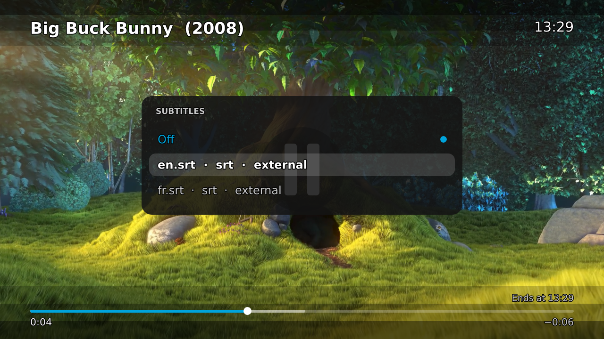

# PiFin

A lightweight Jellyfin hub for Raspberry Pis: flash a card, run one script, and the Pi boots
into a fast native Jellyfin browser on your TV, with hardware-decoded playback and your phone as
the remote.

<p align="center">
  
  &nbsp;&nbsp;
  
</p>

## What you get

- **A native TV app** (Rust + Slint under cage, `app/`): home rows (Continue Watching, Next Up,
  Latest), series pages, posters and backdrops. About 0.7 s from start to home, ~110 MB of
  memory, and frames well under 16 ms at 1080p60. Sign in once with Jellyfin **Quick Connect**:
  the TV shows a code, you approve it from any signed-in Jellyfin app.
- **Hardware-decoded playback** — Play hands the file to mpv, so HEVC, 10-bit and H.264 play
  from the Pi 4's decoders; progress, resume position and watched state go back to Jellyfin.
- **Playback overlay** — a light mpv overlay with title, clock, progress bar, end time and
  audio/subtitle menus on the TV remote's arrows (it costs nothing while hidden).
- **Phone remote** — a web app on port 8080 with no install and no account: d-pad, now
  playing, pause/seek/volume, audio/subtitle pickers, and search with posters (play or open on
  the TV). The TV shows a QR code for it at boot.
- **TV remote** — HDMI-CEC buttons become keys, so a plain TV remote drives the whole UI.
- **Wi-Fi setup hotspot** — with no known network the Pi opens a hotspot and shows a QR code
  on the TV; pick your network on the phone and it carries on by itself. The TV says what the Pi
  is doing ("Connecting to …", then back to the app), and Wi-Fi power save is turned off
  because the Pi 4's radio (brcmfmac) drops and scans slowly with it on.
- **Optional Tailscale** — one auth key and the Pi joins your tailnet; leave it empty and it
  is not even installed.

## Requirements

- Raspberry Pi 4 with 2 GB or more (a Pi 3 is too weak; a Pi 5 should work, untested).
- A TV or monitor over HDMI, and a Jellyfin server you can reach from the Pi.
- On the computer that prepares the card: Python 3 with PyYAML (`pip install pyyaml`) and
  `openssl`.

## Quick start

1. Flash **Raspberry Pi OS Lite 64-bit** (arm64, Trixie) and mount its boot partition.
2. Configure:
   ```bash
   cp pifin.env.example pifin.env
   ./build.py --hash-password          # paste the printed line into pifin.env
   $EDITOR pifin.env                   # JELLYFIN_URL and HOTSPOT_PASS are required
   ```
3. Write it to the card and boot from it:
   ```bash
   ./build.py /run/media/you/bootfs
   ```

First boot does the installs (the PiFin app from the latest GitHub release, mpv, comitup,
optional Tailscale), so give it 10-15 minutes on a wired or good Wi-Fi link. Then sign in with
the Quick Connect code shown on the TV. It resumes after a power
cut, and it deletes its own setup files and one-time keys when it is done.

## Configuration

Everything lives in `pifin.env`; `pifin.env.example` documents each key.

| Key | Required | Default | What it does |
|---|---|---|---|
| `PIFIN_PASS` / `PIFIN_PASS_HASH` | yes | – | login password for the PiFin user (`./build.py --hash-password` makes the hash) |
| `JELLYFIN_URL` | yes | – | the server the TV opens |
| `HOTSPOT_PASS` | yes | – | password of the Wi-Fi setup hotspot |
| `TS_AUTHKEY` | | – | Tailscale auth key; empty skips Tailscale |
| `WIFI_SSID` / `WIFI_PSK` | | – | home Wi-Fi; empty means "use the setup hotspot" |
| `WIFI_COUNTRY` | | – | two-letter radio country code |
| `TIMEZONE` | | `Etc/UTC` | |
| `PIFIN_HOSTNAME` | | `pifin` | mDNS name (`pifin.local`) and tailnet name |
| `PIFIN_USER` | | `pifin` | Linux user the kiosk runs as |
| `SSH_PUBKEY` | | – | file of public keys to install for SSH |
| `HOTSPOT_SSID` | | `PiFin-setup` | |
| `MAX_HEIGHT` | | `720` | render height, scaled up by the TV; lower is smoother |

**Security, in one paragraph.** The PiFin user is created with `sudo NOPASSWD:ALL` and SSH
password auth is on, so first-boot setup can run with nobody at the keyboard. Set a real
password (or install your `SSH_PUBKEY`), and tighten it once the Pi is set up. Only the
one-time Tailscale key and the Wi-Fi password are wiped from the card after setup.

## Layout

`build.py` is the whole installer: it writes cloud-init `user-data` + `network-config` and a
`config.txt` block. `files/` is what gets installed — `pifin-setup.sh` (first boot, one shot
per step, idempotent), the app/CEC/remote systemd units, and `pifin-remote/` (the phone
remote server, its page, and the mpv overlay script). `app/` is the TV app (build it on a Pi
with `cargo build --release`; releases ship a prebuilt aarch64 binary). `tools/` are
development helpers and never run on the Pi.

`pifin-setup.sh` also rewrites comitup's hard-coded `FAIL_TIMEOUT` to 60 s in
`/usr/share/comitup/comitup/states.py`, so a lost network is retried about a minute after a
failed attempt instead of six (the edit is guarded and skipped if upstream changed the line).

## Screenshots

| Phone remote, idle | Phone remote, playing |
|---|---|
|  |  |

| Playback overlay | Subtitle menu (TV remote ↓) |
|---|---|
|  |  |

The phone shots are rendered from the real page with mocked data (`node tools/shot-remote.mjs`).
The TV shots were taken on a Pi 4 playing *Big Buck Bunny* (© Blender Foundation, CC BY 3.0).

## Contributing

Issues and pull requests welcome — say which Pi and which OS you are on, and paste
`journalctl -u pifin-setup -e` (or the unit that misbehaved) for anything boot- or
playback-related. The journal is persistent (capped at 50 MB), so logs survive a reboot.
Wi-Fi complaints should come with `journalctl -u comitup -u NetworkManager`.

- The one rule: **lightweight and fast**. A Pi 4 with 2 GB has to keep up, so prefer fewer
  processes, fewer pixels and less memory over new features.
- Test on a real Pi before opening a pull request: `tools/selftest.sh` only covers the
  install-config path.
- Before pushing: `bash -n files/*.sh files/pifin-comitup-callback`,
  `python3 -m py_compile build.py files/*.py files/pifin-remote/*.py`, and
  `tools/check-leaks.sh` — it keeps other people's network out of this repo.
- No screenshots of your own library, and never commit a `pifin.env`.

## Roadmap

Search on the TV with an on-screen keyboard, movie pages with cast, track choice before Play,
and a Pi 5 test.

## License

MIT — see [LICENSE](LICENSE).
